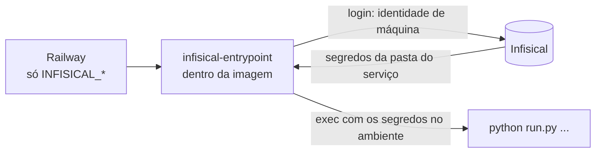

# Cofre de segredos (Infisical)

Os segredos dos serviços ficam no [Infisical](https://infisical.com) e são entregues ao
processo **na hora em que ele sobe**. No Railway sobram só as poucas variáveis que dizem *como
falar com o cofre*; o painel do Railway deixa de guardar JWT, chaves de IA e tokens.



O código do app **não muda**: ele continua lendo variáveis de ambiente. Quem as coloca lá é
`infisical run`, chamado pelo `backend/docker/infisical-entrypoint.sh`
que as três imagens (`Dockerfile`, `Dockerfile.tool-service`, `Dockerfile.mcp-service`) trazem
como `ENTRYPOINT`.

## O que o wrapper garante

| Situação | Resultado |
|---|---|
| Nenhuma `INFISICAL_*` no ambiente | Executa o comando direto. É o caso do docker compose e do desenvolvimento local. |
| Cofre ligado e tudo certo | Faz login, busca a pasta do serviço e sobe o processo com os segredos. |
| Cofre ligado, mas falta variável, o login foi recusado ou o cofre não respondeu | **Não sobe** (código 78). Subir sem os segredos cairia nos valores padrão do código (`change-me-jwt`), o que é pior que ficar fora do ar. O login tenta 3 vezes antes de desistir. |
| `INFISICAL_REQUIRED=true` e o processo não passou pelo wrapper | **Não sobe.** `shared/settings.py` exige a marca `INFISICAL_INJECTED=1`, que só o wrapper põe. |

O CLI é baixado no build, em versão fixa e com o **hash gravado no Dockerfile**. Se o arquivo
publicado mudar, o build falha. Para atualizar, troque a versão e os dois hashes
(`checksums.txt` da release) nos três Dockerfiles.

## O ponto que costuma quebrar: Start command do Railway

O *Start command* do Railway **substitui o `ENTRYPOINT`** do Dockerfile. Serviço com start
command preenchido pula o wrapper em silêncio. Hoje isso vale para o orquestrador:

| Serviço | Start command no Railway |
|---|---|
| `assistant-api` | vazio (usa o `ENTRYPOINT` + `CMD` da imagem) |
| `tool-service` | vazio |
| `mcp-service` | vazio |
| `agent-orchestrator` | **`/usr/local/bin/infisical-entrypoint python -m services.orchestrator.main`** |

Em todos, defina `INFISICAL_REQUIRED=true`: se algum dia o wrapper for pulado, o serviço acusa
o erro no boot em vez de subir com os valores padrão.

## Organização no Infisical

Um projeto (`assistant-app`) com os ambientes `prod` (e `dev`, se quiser) e uma pasta por
serviço:

```
/shared          JWT_SECRET, SECRET_KEY, CREDENTIAL_ENCRYPTION_KEY, INTERNAL_SERVICE_TOKEN
/assistant-api   chaves de provedores, Brevo, LiveKit, Telegram, WhatsApp, OAuth, ...
/orchestrator    QDRANT_API_KEY, LOCALAI_API_KEY, LANGSMITH_API_KEY, ...
/tool-service
/mcp-service
```

- Os valores iguais entre serviços (JWT, chave de cifra, token interno) ficam **uma vez só** em
  `/shared` e entram nas pastas dos serviços por **Secret Imports** (no Infisical: *Add import*).
  O wrapper usa `--include-imports` por padrão, então a importação chega ao processo.
- Crie **uma identidade de máquina por serviço** (*Access Control → Machine Identities*, método
  *Universal Auth*), com acesso de **leitura** só à pasta daquele serviço e a `/shared`. Assim,
  vazar a credencial do `tool-service` não abre as chaves da API.

## Variáveis que ficam no Railway

Em **cada** serviço de aplicação (`assistant-api`, `agent-orchestrator`, `tool-service`,
`mcp-service`):

```dotenv
INFISICAL_PROJECT_ID="<id do projeto>"
INFISICAL_UNIVERSAL_AUTH_CLIENT_ID="<da identidade deste serviço>"
INFISICAL_UNIVERSAL_AUTH_CLIENT_SECRET="<da identidade deste serviço>"
INFISICAL_ENV="prod"
INFISICAL_SECRET_PATH="/assistant-api"      # /orchestrator, /tool-service, /mcp-service
INFISICAL_REQUIRED="true"
# INFISICAL_DOMAIN="https://eu.infisical.com"   # só se a conta não for da nuvem US
```

## O que continua no Railway (e por quê)

| Variável | Motivo |
|---|---|
| `DATABASE_URL`, `REDIS_URL` | São montadas por **referência** (`${{mysql.MYSQL_PASSWORD}}`). Copiar o valor para o cofre perderia a atualização automática quando a senha do banco for regenerada. |
| Variáveis dos serviços `mysql`, `Redis`, `qdrant`, `localai` | São imagens de terceiros, que não passam pelo wrapper. A senha do banco existe obrigatoriamente no próprio serviço. |
| `QDRANT__SERVICE__API_KEY` | Idem (é do serviço `qdrant`). O `QDRANT_API_KEY` do app pode ir para o cofre, mas **o valor tem de ser igual** nos dois lugares. |
| `WHISPER_MODEL` e outras de **build** | O build não lê o cofre; só o processo em execução lê. |
| `HOST`, `PORT`, `RELOAD`, `LOG_LEVEL`, URLs entre serviços, flags | Não são segredos. |

Regra prática: **se vazar não causa dano, pode ficar no Railway.**

## Migração, serviço por serviço

Faça de fora para dentro, um serviço por vez, validando antes do próximo: `mcp-service`,
`tool-service`, `agent-orchestrator`, `assistant-api`.

1. **No Infisical:** crie o projeto, as pastas, os segredos (valores **novos**: não copie os
   que estão sob suspeita de vazamento) e uma identidade de máquina por serviço.
2. **No Railway, no serviço:** adicione as variáveis `INFISICAL_*` da seção acima
   (e, no orquestrador, o start command novo). Mantenha as variáveis antigas por enquanto.
3. **Deploy.** O log deve subir normalmente. Se aparecer `infisical-entrypoint: ...`, o texto
   diz o que faltou.
4. **Valide:** `GET /health` da API e um turno de chat.
5. **Remova do Railway** as variáveis que agora vêm do cofre. Faça *Redeploy* e valide de novo.

Sobre `CREDENTIAL_ENCRYPTION_KEY`: o valor no cofre tem de ser **o mesmo** que cifrou o que já
está no banco (o `JWT_SECRET` antigo, se a instalação nunca definiu a chave). Trocar esse valor
torna ilegíveis as chaves e tokens salvos; só troque com o script de recifragem.

## Dia a dia

- **Trocar um segredo:** altere no Infisical e faça *Redeploy* do serviço. O processo lê o cofre
  **só na subida**; não há recarga automática.
- **Auditoria:** o Infisical registra quem leu e quem mudou cada valor.
- **Cofre fora do ar:** serviço novo ou reiniciado não sobe até ele voltar (o Railway tenta de
  novo). Os que já estão rodando seguem normalmente.
- **Voltar atrás:** apague as `INFISICAL_*` do serviço e recoloque as variáveis no Railway. Sem
  `INFISICAL_*` o wrapper executa o comando direto.

## Quando algo não sobe

| Mensagem no log | Causa |
|---|---|
| `INFISICAL_PROJECT_ID nao definido` (ou `..._CLIENT_ID`/`..._CLIENT_SECRET`) | Variável do Railway faltando neste serviço. |
| `login no Infisical recusado ou fora do ar` | Client id/secret errados, identidade sem acesso ao projeto, ou `INFISICAL_DOMAIN` errado (conta fora da nuvem US). |
| `failed to fetch secrets for path ...` | A pasta de `INFISICAL_SECRET_PATH` não existe, ou a identidade não tem leitura nela. |
| `INFISICAL_REQUIRED=true, mas os segredos nao vieram do cofre` | O start command do serviço substituiu o `ENTRYPOINT`. Chame `/usr/local/bin/infisical-entrypoint` nele. |
| `o CLI do Infisical nao esta na imagem` | Imagem velha, de antes desta mudança. Refaça o deploy. |
