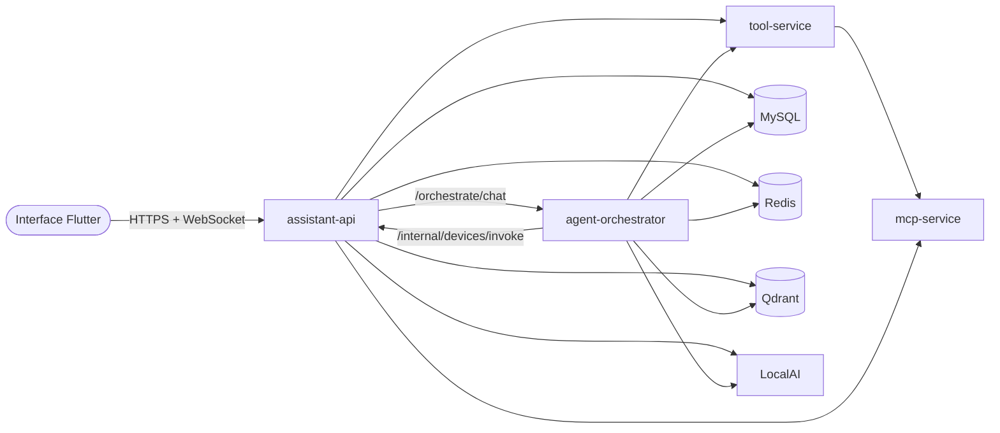
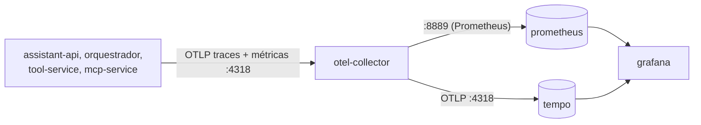
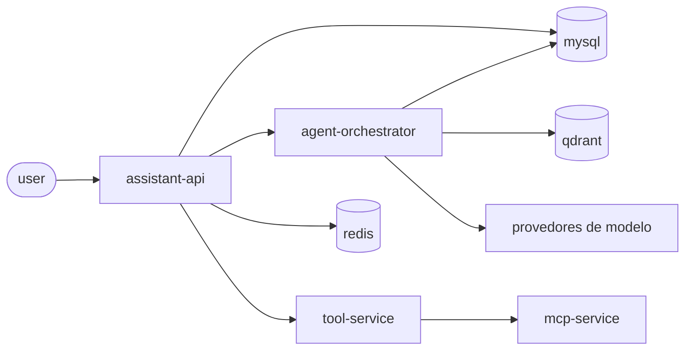

# Deploy na Railway

Guia operacional para subir o backend completo na Railway: quais serviços criar,
em que ordem, com que configuração e quais variáveis. Para o *porquê* de cada
variável, veja [Configuração por serviço](configuracao-por-servico.md); para as
fronteiras entre processos, [Arquitetura agentiva](agentes.md).

> Os nomes de serviço abaixo (`assistant-api`, `agent-orchestrator`,
> `tool-service`, `mcp-service`, `mysql`, `Redis`, `qdrant`, `localai`) são
> sugestões — na instalação de referência a API se chama `assistant_app` e o
> orquestrador, `orchestrator`. Nas referências `${{servico.VARIAVEL}}`, use **exatamente** o nome
> que o serviço tem no seu projeto — inclusive nomes gerados pela Railway, como
> `serene-creation`. Referência para serviço inexistente vira texto vazio, sem
> erro.

---

## Topologia



| Serviço | Origem | Domínio público | Volume | Função |
|---|---|:---:|---|---|
| `assistant-api` | `backend/Dockerfile` | **sim** | `/app/data` | autenticação, rotas, WebSocket, modo educação, voz |
| `agent-orchestrator` | `backend/Dockerfile` | não | `/app/data` (opcional) | grafo do chat |
| `tool-service` | `backend/Dockerfile.tool-service` | não | — | catálogo e governança das ferramentas |
| `mcp-service` | `backend/Dockerfile.mcp-service` | não | — | servidores MCP |
| `mysql` | template Railway ou imagem `mysql` | não | `/var/lib/mysql` | banco relacional |
| `Redis` | template Railway | não | do template | rate limiting e cache de status dos provedores |
| `qdrant` | imagem `qdrant/qdrant:v1.12.6` | não | `/qdrant/storage` | índice vetorial das aulas e memórias |
| `localai` | imagem LocalAI | não | `/models` | LLM local (opcional) |
| `otel-collector` | `infra/otel-collector/Dockerfile` | não | — | recebe traces e métricas da aplicação (opcional) |
| `prometheus` | `infra/prometheus/Dockerfile` | não | `/prometheus` | guarda as métricas (opcional) |
| `tempo` | `infra/tempo/Dockerfile` | não | `/var/tempo` | guarda os traces, 7 dias (opcional) |
| `grafana` | `infra/grafana/Dockerfile` | **sim** | `/var/lib/grafana` | painel de consumo de IA e saúde (opcional) |

Só a `assistant-api` recebe tráfego de fora. Todo o resto conversa pela rede
privada (`*.railway.internal`), que só existe entre serviços do mesmo projeto e
ambiente.

---

## Configuração comum a todos os serviços de aplicação

Os quatro serviços saem do mesmo repositório. Em *Settings* de cada um:

| Campo | Como preencher |
|---|---|
| **Source** | mesmo repositório e mesma branch nos quatro |
| **Root Directory** | `/backend` |
| **Dockerfile Path** | caminho absoluto no repositório, ex.: `/backend/Dockerfile.mcp-service` |
| **Watch Paths** | padrões estilo `.gitignore`, **a partir da raiz do repositório** e com `/` inicial, um por linha |

### Watch paths: o erro que não avisa

Watch path decide quais commits disparam o deploy de cada serviço. Padrão curto
demais não dá erro: o serviço simplesmente não recebe a mudança.

O caso real que motivou esta seção: o `agent-orchestrator` estava com
`/backend/services/orchestrator/**`. Só que o entrypoint dele é um arquivo de
quarenta linhas — **o grafo, os nós e as regras que ele executa moram em
`/backend/app/**`**. Uma correção de roteamento do chat subiu na API e nunca
chegou ao orquestrador, que é onde o chat roda com `ORCHESTRATOR_TRANSPORT=remote`.

Regras práticas:

- serviço que carrega código de `app/` (API, orquestrador, tool-service) observa
  `/backend/app/**`;
- todo serviço observa `/backend/shared/**` e `/backend/services/common.py`;
- na dúvida, deixe o campo **vazio**: todo commit dispara o deploy. Deploy a
  mais custa minutos; deploy a menos deixa produção rodando código velho;
- **mudar o watch path não redeploya o que já foi enviado.** Depois de corrigir,
  faça *Deploy latest commit* à mão;
- para saber o que está no ar, `GET /health` ou `GET /health/live` da API mostram o commit
  (`RAILWAY_GIT_COMMIT_SHA`); compare com o deploy de cada serviço em
  *Deployments*.

---

## Ordem de criação

Crie de dentro para fora e confira cada serviço antes do próximo — quando algo
falhar, o culpado é o último que você mexeu.

1. `mysql`, `Redis`, `qdrant` (e `localai`, se usar), com **App Sleeping
   desligado**: serviço dormindo só acorda no primeiro acesso, e o boot da API
   e do orquestrador pode pegá-lo ainda parado
2. `mcp-service`
3. `tool-service`
4. `agent-orchestrator`
5. `assistant-api`

---

## Segredos

Gere uma vez e guarde num cofre:

```bash
python -c "import secrets; print(secrets.token_hex(32))"      # SECRET_KEY
python -c "import secrets; print(secrets.token_hex(32))"      # JWT_SECRET
python -c "import secrets; print(secrets.token_hex(32))"      # CREDENTIAL_ENCRYPTION_KEY
python -c "import secrets; print(secrets.token_urlsafe(48))"  # INTERNAL_SERVICE_TOKEN
```

| Segredo | Onde | Regra |
|---|---|---|
| `SECRET_KEY`, `JWT_SECRET` | `assistant-api`, `agent-orchestrator` | iguais nos dois |
| `CREDENTIAL_ENCRYPTION_KEY` | `assistant-api`, `agent-orchestrator` | iguais nos dois; **nunca rotacione** — as chaves salvas no banco deixam de abrir |
| `INTERNAL_SERVICE_TOKEN` | `assistant-api`, `agent-orchestrator` | iguais nos dois; vazio fecha as rotas internas |

> **Instalação que já rodou sem `CREDENTIAL_ENCRYPTION_KEY`** cifrou as
> credenciais com o `JWT_SECRET`. Para não perder nada, use o valor atual do
> `JWT_SECRET` também como `CREDENTIAL_ENCRYPTION_KEY`.

Uma alternativa a repetir valores é a Railway **Shared Variables** do ambiente,
referenciada como `${{shared.JWT_SECRET}}`.

---

## Infraestrutura

### MySQL e Redis

O Redis vem do template da Railway e publica `REDIS_URL`.

O MySQL pode ter sido criado de dois jeitos, e **os nomes das variáveis mudam**
entre eles. Abra a aba *Variables* do serviço e veja qual conjunto existe:

| Criado a partir de | Ícone no canvas | Variáveis publicadas | `DATABASE_URL` |
|---|---|---|---|
| Template MySQL da Railway | logo do MySQL | `MYSQLUSER`, `MYSQLPASSWORD`, `MYSQLDATABASE` | `mysql+aiomysql://${{MySQL.MYSQLUSER}}:${{MySQL.MYSQLPASSWORD}}@${{MySQL.RAILWAY_PRIVATE_DOMAIN}}:3306/${{MySQL.MYSQLDATABASE}}` |
| Imagem Docker `mysql` | cubo | `MYSQL_USER`, `MYSQL_PASSWORD`, `MYSQL_DATABASE` (as que você definiu) | `mysql+aiomysql://${{mysql.MYSQL_USER}}:${{mysql.MYSQL_PASSWORD}}@${{mysql.RAILWAY_PRIVATE_DOMAIN}}:3306/${{mysql.MYSQL_DATABASE}}` |

Referência a variável que não existe resolve **vazia**, e a URL vira
`mysql+aiomysql://:@host:3306/`. O backend detecta isso no boot e registra
`DATABASE_URL incompleta: usuario vazio, nome do banco vazio`; sem esse aviso, o
driver só diria `Access denied for user 'app'`, o usuário do container. Confira
o valor resolvido passando o mouse sobre a variável no painel.

A `MYSQL_URL` do template começa com `mysql://` (driver síncrono). Se usá-la, o
backend troca para `mysql+aiomysql://` sozinho e avisa no log, mas prefira montar
a URL como na tabela.

Os blocos abaixo usam a imagem Docker (`mysql`, com `MYSQL_USER`). Com o
template, troque pela linha da tabela.

### qdrant

- **Imagem:** `qdrant/qdrant:v1.12.6`
- **Volume:** `/qdrant/storage`

```dotenv
# Opcional. Se definir, repita o valor em QDRANT_API_KEY da API e do orquestrador.
QDRANT__SERVICE__API_KEY=
# Só em ambiente Railway antigo, com rede privada apenas IPv6:
# QDRANT__SERVICE__HOST=::
```

### localai

Configuração completa na seção *Ollama E LocalAI Na Railway* do `README.md` da raiz. Resumo:
volume em `/models`, `LOCALAI_ADDRESS=:8080` e o modelo em `PRELOAD_MODELS`.
`LOCALAI_MODEL` na API e no orquestrador precisa ser o `id` instalado no LocalAI.

### Observabilidade: otel-collector, prometheus, tempo e grafana (opcional)

Quatro serviços que só valem criar quando for olhar traces e métricas. Sem eles, deixe
`OTEL_ENABLED="false"` nos serviços da aplicação: com a telemetria ligada e sem collector
alcançável, o SDK registra falha de envio a cada lote.



O collector recebe traces e métricas da aplicação. Os traces vão para o log dele e também viram
métricas de chamadas, erros e latência por tipo de operação (`spanmetrics`). As métricas da
aplicação são: tokens, custo estimado, chamadas e duração das chamadas a modelos (por provedor e
modelo) e a duração das requisições HTTP (por rota). O collector as expõe na porta `8889`, o
Prometheus busca por lá e o Grafana lê do Prometheus.

O collector também entrega os traces ao `tempo` (porta `4318`), que o Grafana consulta na `3200`: é dele que vêm o mapa de serviços e a busca de traces.

**Os nomes dos serviços importam**: `prometheus.yml`, o collector e as fontes de dados do Grafana usam
`otel-collector.railway.internal`, `prometheus.railway.internal` e `tempo.railway.internal`.

#### Variáveis de observabilidade, serviço por serviço

Os três serviços novos **não leem** variável `OTEL_*`: o que eles precisam já está nos arquivos
da pasta `infra/`. As variáveis abaixo vão **nos serviços da aplicação**. (O `otel-collector` lê
outras, `MYSQL_*` e `REDIS_*`, para a saúde dos bancos: veja *MySQL, Redis e Qdrant no Grafana*.)

| Serviço | `OTEL_ENABLED` | `OTEL_EXPORTER_ENDPOINT` | Também vale | O que ele envia |
|---|:---:|:---:|---|---|
| `assistant-api` | `true` | sim | `OTEL_SERVICE_NAME`, `LANGSMITH_*` | traces, duração das requisições, **tokens** (exatos) e **custo estimado** do resumo de aula, quiz, melhoria de material e chat |
| `agent-orchestrator` | `true` | sim | `LANGSMITH_*` | traces, duração das requisições, **tokens** (exatos) e **custo estimado** do chat |
| `tool-service` | `true` | sim | — | traces e duração das requisições |
| `mcp-service` | `true` | sim | — | traces e duração das requisições |
| `otel-collector`, `prometheus`, `grafana` | não leem `OTEL_*` | — | — | — |

Em cada um dos quatro:

```dotenv
OTEL_ENABLED="true"
# Aceita a URL base: o codigo acrescenta /v1/traces e /v1/metrics. A URL completa de traces,
# usada antes, continua valendo.
OTEL_EXPORTER_ENDPOINT="http://${{otel-collector.RAILWAY_PRIVATE_DOMAIN}}:4318"
```

- `OTEL_SERVICE_NAME` só é lida pela `assistant-api` (padrão `assistant-api`); os outros três
  passam o próprio nome no código, e definir a variável neles não renomeia nada.
- **Tokens são exatos; o custo é uma estimativa.** Cada cliente escolhe a própria chave e o próprio
  modelo, e isso fica no banco dele. O preço é **por modelo**, numa tabela do banco que o
  administrador edita no app (Configurações → Consumo de IA → Preços) e que ele pode importar de uma
  tabela pública. Não é variável do Railway: o `LLM_PRICING` só serve de reserva e não acompanha o
  modelo de cada cliente. Veja [Consumo e preços de IA](../funcionalidades/consumo-e-precos-de-ia.md).
  Um modelo sem preço próprio usa o padrão do provedor, que é só uma ordem de grandeza.
- Os quadros de **consumo** do Grafana (tokens, custo, chamadas, por modelo e por cliente) leem do
  **banco** (tabela `llm_usage_hourly`), que guarda o número exato por hora, provedor, modelo e cliente.
  As métricas do Prometheus ficam só para latência e saúde: elas somam todos os clientes (um rótulo por
  cliente criaria uma série por cliente) e perdem a primeira contagem de cada série nova, o que
  distorce justamente um uso pequeno. O mesmo consumo aparece no app (Configurações → Consumo de IA).
- `LANGSMITH_*` não pertence ao `tool-service` nem ao `mcp-service`: lá ela liga um rastreamento
  que nunca receberá chamada de modelo, e a chave ficaria exposta sem uso.
- `OTEL_CONSOLE_EXPORT` e `TELEMETRY_MEMORY_EVENTS` não precisam mudar. Com a telemetria
  ligada, a janela em memória da tela de diagnóstico continua funcionando.

Cada mudança de variável redeploya o serviço, então altere um de cada vez, começando pelo
`assistant-api`.

#### Dois caminhos para criar os três serviços

**Pelo Infrastructure as Code (recomendado).** O arquivo `.railway/railway.ts` declara os três
serviços, os dois volumes (`prometheus-data` e `grafana-storage`) e as variáveis fixas
(`RAILWAY_RUN_UID`, a senha do Grafana vinda de uma variável compartilhada). A CLI aplica, em vez
de criar tudo pelo painel. É uma **parcial nomeada** (`observability`): ela só apaga o que ela mesma
criou, então o resto do projeto (a API, o MySQL, o Redis, o Qdrant) não é tocado. Um `apply`
comum, sem parcial, **apagaria** o que não estivesse no arquivo, e por isso o arquivo precisa
manter o `export const partial`.

Preparação, uma vez:

```powershell
npm install -g @railway/cli --allow-scripts=@railway/cli   # o npm bloqueia o script que baixa o binario
npm install --save-dev railway                              # na raiz do repositorio: o SDK que o arquivo importa
railway login
railway link                                                # escolha o projeto e o ambiente
```

Antes do primeiro `apply`:
1. apague o `otel-collector` criado à mão, se existir (o nome é o mesmo);
2. crie a variável compartilhada `GRAFANA_ADMIN_PASSWORD` em *Project Settings > Shared
   Variables*, com uma senha forte (veja o aviso do Grafana abaixo);
3. confira `REGION` no arquivo: ela precisa ser a região dos serviços (hoje `us-east4-eqdc4a`,
   Virginia). Volume e serviço têm de estar na mesma.

```powershell
# No Windows (PowerShell): o SDK confere a versao da CLI rodando `railway`, e o atalho .cmd que o
# npm cria nao e executavel assim. Aponte para o binario real.
$env:_ = "$env:APPDATA\npm\node_modules\@railway\cli\bin\railway.exe"

railway config plan --verbose   # so mostra o que mudaria; leia antes
railway config apply            # pede confirmacao
```

O `plan` deve mostrar só criações (`5 to add, 0 to change, 0 to destroy`). Qualquer remoção ou
alteração em `assistant-api`, `mysql`, `redis` ou `qdrant` significa que a parcial não está
protegendo: **não aplique**. Para detalhes, `railway config plan --full` (evite `--show-values`
e `--decrypt-variables`, que imprimem a senha).

O IaC **não** cobre, e continua no painel:
- o **domínio público** do Grafana (domínio gerado pelo Railway não entra no arquivo; gere em
  *Settings > Networking*, porta `3000`);
- *Watch Paths*, limite de CPU e memória, e serverless (o campo não existe no IaC);
- as variáveis `OTEL_*` da aplicação, que estão fora da parcial.

Cada serviço sai de uma pasta com um arquivo chamado `Dockerfile` (`infra/otel-collector`,
`infra/prometheus`, `infra/grafana`), porque o IaC não tem campo para o caminho do Dockerfile e o
Railway só detecta um arquivo com esse nome na Root Directory. Um serviço gerido pelo IaC não deve
ser editado no painel nos campos que o arquivo declara.

**Pelo painel.** O compose monta os arquivos de configuração por volume, e o Railway não faz isso
com imagem pronta. Por isso cada serviço sai de um Dockerfile que copia a configuração para
dentro da imagem. Os campos de cada serviço estão a seguir.

#### `otel-collector`

| Campo | Valor |
|---|---|
| Source | mesmo repositório e mesma branch |
| Root Directory | `/infra/otel-collector` |
| Dockerfile Path | vazio (o Railway detecta o `Dockerfile` da pasta) |
| Watch Paths | `/infra/otel-collector/**` |
| Domínio público | **não**: só a rede privada recebe telemetria |
| Volume | nenhum |

Healthcheck opcional: `PORT="13133"` e caminho `/` (a extensão `health_check` do collector).

#### `prometheus`

| Campo | Valor |
|---|---|
| Source | mesmo repositório e mesma branch |
| Root Directory | `/infra/prometheus` |
| Dockerfile Path | vazio (o Railway detecta o `Dockerfile` da pasta) |
| Watch Paths | `/infra/prometheus/**` |
| Domínio público | **não** (a API do Prometheus não tem autenticação) |
| Volume | `/prometheus` (histórico de 30 dias) |

```dotenv
# A imagem roda sem root e o volume do Railway monta como root: sem isto o Prometheus nao
# consegue escrever e cai no boot com "permission denied".
RAILWAY_RUN_UID="0"
```

#### `tempo`

| Campo | Valor |
|---|---|
| Source | mesmo repositório e mesma branch |
| Root Directory | `/infra/tempo` |
| Dockerfile Path | vazio (o Railway detecta o `Dockerfile` da pasta) |
| Watch Paths | `/infra/tempo/**` |
| Domínio público | **não** |
| Volume | `/var/tempo` (traces de 7 dias) |

```dotenv
# Pelo mesmo motivo do Prometheus.
RAILWAY_RUN_UID="0"
```

#### `grafana`

| Campo | Valor |
|---|---|
| Source | mesmo repositório e mesma branch |
| Root Directory | `/infra/grafana` |
| Dockerfile Path | vazio (o Railway detecta o `Dockerfile` da pasta) |
| Watch Paths | `/infra/grafana/**` |
| Domínio público | **sim**, na porta `3000` |
| Volume | `/var/lib/grafana` |

```dotenv
# Obrigatoria. O usuario e `admin`; o servico tem dominio publico, entao use uma senha forte.
GF_SECURITY_ADMIN_PASSWORD="<senha forte>"
# Pelo mesmo motivo do Prometheus.
RAILWAY_RUN_UID="0"
# Opcional: o endereco publico, para links e convites saírem certos.
# GF_SERVER_ROOT_URL="https://<dominio-do-grafana>"
```

Nada se configura na interface do Grafana: as fontes de dados e os painéis já vêm provisionados, na
pasta *Assistant*:

| Fonte de dados | Lê de | Usada para |
|---|---|---|
| `Prometheus` | o Prometheus do projeto | latência, requisições HTTP, operações e a saúde dos bancos |
| `Tempo` | o Tempo do projeto | o mapa de serviços (Service Graph) e os traces |
| `App (MySQL)` | o banco da aplicação, com o usuário `monitor` | o consumo de IA, exato |

Os dois painéis são dinâmicos: **tudo segue o seletor de tempo do alto** (padrão 7 dias no de consumo e
24 horas no de infraestrutura), sem período escondido em nenhum quadro.

- **Assistant · consumo de IA e saúde:** totais, tabelas e gráficos cobrem o período do seletor. A lista
  **"Agrupar por"** define o passo dos gráficos (hora, 6 horas, dia ou 7 dias); em `auto` ele cresce com o
  período, e nunca é menor que 1 hora, que é como o dado é guardado. O consumo anterior à tabela por hora só
  tem o total do dia, então só aparece quando o passo é de um dia ou mais.
- **Latência e saúde** (Prometheus) seguem o mesmo seletor.
- **Fuso horário:** o consumo é guardado em UTC. As consultas do Grafana contam a partir da época (1970-01-01, UTC),
  e não do fuso da sessão do MySQL, então o período certo aparece qualquer que seja o fuso do banco ou do navegador.

O painel **Assistant · MySQL, Redis e Qdrant** segue o seletor de tempo do alto em tudo (padrão 24 horas),
sem períodos escondidos. Dois ajustes evitam o quadro vazio:

- A lista **"Janela de cálculo"** (5 min a 1 dia; padrão 1 hora) define em quanto tempo se somam os eventos
  raros: erros de conexão, chaves expiradas ou expulsas, e requisições, latência e falhas do Qdrant. Com
  pouco tráfego, aumente a janela; para ver o detalhe de um incidente, diminua.
- Contadores de evento raro (consultas lentas, falhas) mostram **0** quando nada aconteceu, em vez de "sem dado".

As faixas dos histogramas de duração (chamadas a modelos e requisições HTTP) vão de meio segundo a dois
minutos. As do SDK terminam em 10 segundos, e uma chamada de 30 segundos fazia o p95 do gráfico ficar
preso em 10 s.

A fonte `App (MySQL)` lê as variáveis `GRAFANA_DB_HOST`, `GRAFANA_DB_NAME`, `GRAFANA_DB_USER` e
`GRAFANA_DB_PASSWORD` do **serviço do Grafana** (o IaC já as define; no painel, preencha à mão). Sem
elas o Grafana sobe normalmente, e só os quadros de consumo ficam sem dado.

#### Ordem e conferência

Ordem: `otel-collector`, depois `prometheus`, depois `grafana`, e por fim as variáveis `OTEL_*` da
aplicação. As métricas aparecem no painel cerca de um minuto depois da primeira chamada a um modelo.

Para conferir o caminho por partes:
1. nos logs do collector aparece `Everything is ready` e, depois, os traces (exporter `debug`);
2. no Grafana, *Connections > Data sources > Prometheus > Test* deve dar **OK**. Isso prova que o
   Grafana alcança o Prometheus pela rede privada, e é o único jeito de ver, porque o Prometheus não
   tem domínio público;
3. no painel **Assistant · consumo de IA e saúde**, os quadros de tokens e custo só enchem depois de
   uma chamada de resumo, quiz, melhoria de material ou chat.

#### Senha do Grafana (leia antes de gerar o domínio)

O serviço tem domínio público. Duas armadilhas:

- **Variável vazia.** Se `GRAFANA_ADMIN_PASSWORD` não existir como variável compartilhada, a
  referência `${{shared.GRAFANA_ADMIN_PASSWORD}}` resolve **vazia** (`<empty string>` na lista de
  variáveis) e o Grafana volta ao padrão `admin` / `admin`. Confira o valor resolvido e, antes de
  expor, tente entrar com `admin` / `admin`: se entrar, apague o domínio.
- **O Grafana só lê a senha na primeira subida**, quando cria o banco no volume. Trocar a variável
  depois não muda a senha de um banco que já existe. Se o serviço subiu uma vez com a variável
  vazia, resete a senha ou recrie o volume.

Para resetar a senha (a CLI pede uma chave SSH cadastrada, e a senha digitada fica só no terminal):

```powershell
ssh-keygen -t ed25519
railway ssh keys add
railway ssh --service grafana
# dentro do container:
grafana cli --homepath /usr/share/grafana admin reset-admin-password "SUA-SENHA-FORTE"
```

Para recriar o volume em vez de resetar: apague o volume no painel e troque o nome dele em
`.railway/railway.ts` (hoje `grafana-storage`). **O Railway guarda um volume apagado por cerca de
dois dias**, e nesse período o nome continua ocupado: recriar com o mesmo nome dá "já existe no
projeto" (`railway volume list` mostra a data em *Deletes on*). Nome novo evita a espera.

#### MySQL, Redis e Qdrant no Grafana

O painel **Assistant · MySQL, Redis e Qdrant** (pasta *Assistant*) mostra a saúde dos três bancos:

- **MySQL:** tempo no ar, conexões abertas, consultas por segundo e por tipo, consultas lentas, linhas
  lidas e gravadas, memória do buffer pool, tráfego de rede e erros de conexão.
- **Redis:** clientes, memória (usada, do sistema e pico), chaves, comandos por segundo, taxa de
  acertos do cache, rede e chaves expulsas por falta de memória (sinal de que o Redis está cheio).
- **Qdrant:** coleções, memória, requisições por segundo e latência p95 por rota, e falhas.

Como cada um chega ao Grafana:

| Banco | Caminho | O que precisa |
|---|---|---|
| MySQL | receptor `mysql` do collector, a cada 30 s | um usuário **só de leitura** e a senha dele |
| Redis | receptor `redis` do collector, a cada 30 s | o endereço e a senha do serviço |
| Qdrant | o Prometheus lê o `/metrics` dele | só o nome de rede `qdrant.railway.internal` |

**1. Usuário de leitura no MySQL.** Rode uma vez, no terminal do serviço `mysql` (o *Console* do
serviço no painel, ou `railway ssh --service mysql`). O terminal do container é um **bash**, e o SQL só
funciona dentro do cliente `mysql`: colar o `CREATE USER` direto no bash dá `command not found` (e
nada é criado).

1. Entre no cliente como administrador:

   ```bash
   mysql -uroot -p"$MYSQL_ROOT_PASSWORD"
   ```

   O prompt muda para `mysql>`. Se der `Access denied` ou a variável estiver vazia, confira em
   *Variables* do serviço `mysql` qual é a senha do administrador (`MYSQL_ROOT_PASSWORD`): o
   usuário da aplicação (`MYSQL_USER`) provavelmente não tem permissão para criar usuários.

2. No prompt `mysql>`, rode as linhas abaixo, **trocando `SUA-SENHA-AQUI` pela senha de verdade**
   (forte, sem aspas simples nem barras invertidas, usada só para isso) e **`assistant` pelo nome do
   seu banco** (o valor de `MYSQL_DATABASE` do serviço `mysql`):

   ```sql
   CREATE USER 'monitor'@'%' IDENTIFIED BY 'SUA-SENHA-AQUI';
   GRANT PROCESS, REPLICATION CLIENT ON *.* TO 'monitor'@'%';
   GRANT SELECT ON performance_schema.* TO 'monitor'@'%';
   GRANT SELECT ON assistant.llm_usage_hourly TO 'monitor'@'%';
   GRANT SELECT (tutor_id, email, username) ON assistant.users TO 'monitor'@'%';
   ```

   | Permissão | Para quê |
   |---|---|
   | `PROCESS`, `REPLICATION CLIENT` e `performance_schema` | as métricas de saúde do MySQL (collector) |
   | `llm_usage_hourly` | o consumo de IA no Grafana (uma tabela de números, sem dado pessoal) |
   | três colunas de `users` | mostrar o e-mail do cliente no quadro "Consumo por cliente" |

   Ele **não** lê o resto do banco: nem `password_hash`, nem as aulas, os alunos ou as conversas.
   Testado: `SELECT password_hash` e `SELECT *` em `users` dão `command denied`, e `INSERT` também.

   Se você já criou o `monitor` quando a tabela de consumo era por dia (`llm_usage_daily`), ele precisa
   da permissão da tabela nova, senão os quadros de consumo dão `SELECT command denied`:
   `GRANT SELECT ON assistant.llm_usage_hourly TO 'monitor'@'%';` (a da tabela antiga pode ficar, ou ser
   revogada com `REVOKE SELECT ON assistant.llm_usage_daily FROM 'monitor'@'%';`).

   Se o usuário já existir (`ERROR 1396`), troque o `CREATE USER` por
   `ALTER USER 'monitor'@'%' IDENTIFIED BY 'SUA-SENHA-AQUI';`. Se você já o criou com a permissão
   ampla (`SELECT ON *.*`) de uma versão anterior deste guia, tire-a e dê as de cima:
   `REVOKE SELECT ON *.* FROM 'monitor'@'%';`.

3. Confira e saia:

   ```sql
   SHOW GRANTS FOR 'monitor'@'%';
   exit
   ```

   A saída deve listar as cinco permissões acima, e nenhum `SELECT ON *.*`.

Esse usuário só lê e não escreve em nada. Não use o usuário da aplicação: ele tem mais permissão do que
a monitoria precisa, e a senha dele ficaria espalhada em mais um serviço. Não cole a senha em chat nem
em arquivo do repositório: o comando fica no histórico do terminal do container.

**2. Variável compartilhada.** Em *Project Settings > Shared Variables*, crie
`MYSQL_MONITOR_PASSWORD` com a mesma senha. O IaC a referencia (no collector e no Grafana), e ela não vai
para o repositório.

**3. Redis.** O `.railway/railway.ts` lê `${{Redis.REDIS_PASSWORD}}` e `${{Redis.RAILWAY_PRIVATE_DOMAIN}}`.
Confira em *Redis > Variables* que `REDIS_PASSWORD` existe com esse nome (o template do Railway pode
chamá-la de outro jeito, como `REDISPASSWORD`); se for outro, ajuste o nome no arquivo. O nome do
serviço no painel é `Redis`, com R maiúsculo, e a referência precisa casar com ele.

**4. Aplicar.** O `plan` deve mostrar só variáveis novas: cinco no `otel-collector` (endereço e senha
do MySQL e do Redis) e quatro no `grafana` (`GRAFANA_DB_*`), sempre com `0 to add` e `0 to destroy`.
Depois do `apply`, os dois serviços redeployam. A configuração do Prometheus (a leitura do Qdrant), a
fonte de dados `App (MySQL)` e os painéis entram com o push do repositório.

```powershell
railway config plan --verbose
railway config apply
```

**5. Conferir.** No Grafana, *Explore*, rode `up{job="qdrant"}` (deve dar `1`) e abra o painel: os
quadros de MySQL e Redis enchem em cerca de um minuto. Nos logs do collector, `access denied`
(MySQL) ou `NOAUTH` (Redis) indicam usuário ou senha errados.

**Atenção com o Qdrant e o serverless.** O Prometheus lê o `/metrics` do Qdrant a cada 15 segundos, e
cada resposta conta como tráfego de saída. O Railway só deixa dormir um serviço sem tráfego por 5 a 10
minutos, então **um Qdrant com serverless ligado deixa de dormir** enquanto for monitorado. Escolha:
monitorar o Qdrant (e desligar o serverless dele), ou manter o serverless e tirar o trecho
`job_name: qdrant` do `infra/prometheus/prometheus.yml`. Se o Qdrant tiver chave de API
(`QDRANT__SERVICE__API_KEY`), a leitura do `/metrics` pode falhar com 401: avise antes de ligar.

Verificado em teste local com `mysql:8.4`, `redis:7` e `qdrant:v1.12.6`, não contra as imagens do
Railway: o template do Redis do Railway e a versão do seu MySQL podem expor métricas ou nomes
levemente diferentes. As métricas de MySQL que o receptor traz desligadas (conexões, consultas,
comandos, rede e erros) estão ligadas no `otel-collector.yaml`.

#### Dimensionamento e serverless

Os três cabem em **1 vCPU e 1 GB** com folga (o collector tem limitador de memória em 75% do que o
container tiver; o Prometheus guarda poucas centenas de séries; o Grafana usa algumas centenas de
MB). O que o painel mostra é o **limite máximo** por réplica, e a cobrança é pelo uso real: baixar
o limite funciona como teto de segurança, não como economia. Configure em *Settings > Replica Limits*
de cada serviço; o IaC não tem esse campo.

**Serverless** só no Grafana. O Railway considera o serviço inativo depois de 5 a 10 minutos sem
pacote de saída, e o tráfego pela rede privada conta nos dois sentidos:
- o **Prometheus** busca as métricas a cada 15 segundos, então nunca dorme;
- o **collector** responde a essas buscas (e recebe os dados da aplicação), então também não dorme;
- o **Grafana** só é usado quando alguém abre o painel, então dorme e acorda na próxima visita. A
  primeira requisição pode demorar e devolver 502 (recarregar resolve).

Ligar nos três não quebra nada, mas é inútil nos dois primeiros. O serverless só vale para o
container novo: depois de ligar, faça um redeploy.

#### Mapa da requisição

O painel **Assistant · mapa da requisição** desenha por onde a requisição passa: quem chama quem, quantas
vezes, quanto demora e onde falha.



Ele é montado a partir dos traces, sem serviço novo:

1. **Na aplicação**: cada requisição que entra abre um span de servidor e herda o `traceparent` que veio
   no cabeçalho. Cada chamada que sai (HTTP, Redis e consultas ao MySQL) abre um span de cliente, e as
   chamadas HTTP levam o `traceparent` junto. É isso que liga o trace da API ao do orquestrador, da
   tool-service e do MCP.
2. **No `otel-collector`**: o conector `servicegraph` casa o span de cliente de um serviço com o span de
   servidor do outro e conta chamadas, falhas e latência de cada par. Um processador dá nome ao destino
   das chamadas que saem: `mysql`, `redis` e `qdrant`, e o domínio dos demais (um provedor de modelo, por
   exemplo).
3. **No Grafana**: o painel lê essas métricas do Prometheus (`traces_service_graph_*`).

O que o painel mostra, tudo no período do seletor de tempo do alto (padrão 30 minutos, atualizando a
cada 10 segundos):

- **Mapa de serviços:** cada círculo é um serviço, banco ou API externa. A cor mostra a saúde (verde: sem
  falha; laranja: até 5% das chamadas recebidas falharam; vermelho: 5% ou mais) e o número dentro é a
  taxa de falha. `user` é quem chama a API de fora (a interface, o portal). As APIs externas (provedores
  de modelo, Google, Hugging Face) aparecem juntas em um nó, **serviços externos**; o detalhe de cada uma
  está na tabela "Cada ligação". O desenho se monta sozinho: um serviço novo aparece quando recebe tráfego.
- **Fluxo ao vivo:** o caminho principal num desenho fixo, com a linha correndo. A espessura é a
  quantidade de chamadas por segundo e a cor é a taxa de falha (cinza: sem dado; verde: sem falha;
  laranja: com falha; vermelho: 5% ou mais). Por ser fixo, serviço novo aparece primeiro no mapa.
- **Totais, tabela "Cada ligação" e gráficos:** chamadas, falhas, taxa de falha e latência (p95 e média)
  de cada par origem → destino.

Para o mapa aparecer, os **quatro** serviços da aplicação precisam de `OTEL_ENABLED=true` e do
`OTEL_EXPORTER_ENDPOINT` (veja a tabela acima): serviço sem telemetria fica de fora do desenho, e a
ligação até ele aparece como um destino sem saída. O mapa só tem dado depois que há tráfego; as
métricas aparecem uns 30 segundos depois da primeira requisição. A ligação até o MySQL só existe se o
`opentelemetry-instrumentation-sqlalchemy` estiver na imagem (está no `requirements.txt`).

#### Problemas comuns da observabilidade

| Sintoma | Causa | O que fazer |
|---|---|---|
| Build do collector: *Root directory "infra/otel-collector" was not found* | a pasta nova ainda não está no GitHub (o Railway constrói do repositório) | commitar e dar push |
| O diagnóstico do Railway sugere *Fix root directory* | ele quer voltar ao layout antigo | não aceite; desligue o *Run automatically*, que pode aplicar a correção sozinho e abrir um PR que reescreve o Dockerfile |
| `railway config plan` reclama de versão da CLI mesmo com a 5.70 | no Windows o SDK não executa o atalho `.cmd` | `$env:_` apontando para o `railway.exe` |
| `npm install -g @railway/cli` instala, mas `railway` não acha o binário | o npm bloqueou o script que o baixa | `npm install -g @railway/cli --allow-scripts=@railway/cli` |
| *Volume já existe no projeto* | volume apagado ainda em retenção | nome novo no `railway.ts`, ou esperar a data de *Deletes on* |
| Senha do Grafana vazia ou `admin` | variável compartilhada ausente, ou banco criado antes dela | seção *Senha do Grafana* acima |
| Quadros de consumo vazios (tokens, custo, por modelo e por cliente) | a fonte `App (MySQL)` não conecta (usuário `monitor` sem criar, senha diferente, ou `GRAFANA_DB_*` ausentes), ou ninguém chamou um modelo no período | *Connections > Data sources > App (MySQL) > Test*; criar o usuário e conferir as variáveis do Grafana |
| Só os quadros de latência e saúde vazios | `OTEL_ENABLED` está `false` na `assistant-api`, ou ainda não houve chamada | conferir a variável e disparar um resumo |
| `permission denied` no boot do Prometheus ou do Grafana | a imagem roda sem root e o volume monta como root | `RAILWAY_RUN_UID="0"` (o IaC já define) |
| Painel de infra sem dados do MySQL; log do collector com `access denied` | usuário `monitor` não existe, ou a senha de `MYSQL_MONITOR_PASSWORD` é outra | criar o usuário e a variável compartilhada com a mesma senha |
| `CREATE: command not found` ao criar o usuário `monitor` | o SQL foi colado no bash do container, não no cliente do MySQL | `mysql -uroot -p"$MYSQL_ROOT_PASSWORD"` e colar no prompt `mysql>` |
| Painel de infra sem dados do Redis; log com `NOAUTH` ou `WRONGPASS` | `REDIS_PASSWORD` não resolveu (nome da variável diferente no template) | conferir *Redis > Variables* e o nome no `railway.ts` |
| `up{job="qdrant"}` em `0`, ou o Qdrant nunca mais dorme | o Qdrant dormiu e a leitura falhou, ou o monitoramento o mantém acordado | desligar o serverless do Qdrant, ou tirar o `job_name: qdrant` do `prometheus.yml` |

Em ambiente Railway antigo, de rede privada só IPv6, o collector e o Prometheus precisam escutar
em `[::]` em vez de `0.0.0.0` (receptor `otlp` e exporter `prometheus` em
`infra/otel-collector/otel-collector.yaml`, e `--web.listen-address` no Dockerfile do Prometheus),
como o aviso do `qdrant` acima.

Para guardar traces e consultá-los, acrescente um exporter de traces em
`infra/otel-collector/otel-collector.yaml`, por exemplo `otlphttp` para um backend gerenciado, com a
chave em uma variável do serviço (`${env:NOME}` no YAML) e nunca escrita no arquivo.

---

## `mcp-service`

| Configuração | Valor |
|---|---|
| Root Directory | `/backend` |
| Dockerfile Path | `/backend/Dockerfile.mcp-service` |
| Start command | vazio (o `CMD` da imagem) |
| Healthcheck | `/health/live` |
| Domínio público | nenhum |

```dotenv
HOST="0.0.0.0"
PORT="8002"
RELOAD="false"
LOG_LEVEL="info"

# JSON; vazio é válido (serviço sobe sem servidores).
# stdio com npx exige imagem construída com WITH_NODE=true.
MCP_SERVERS=""
MCP_TIMEOUT_SECONDS="30"
MCP_MAX_RETRIES="2"
MCP_RETRY_BACKOFF_SECONDS="0.5"
MCP_CIRCUIT_FAILURE_THRESHOLD="3"
MCP_CIRCUIT_RESET_SECONDS="60"
MCP_TOOLS_CACHE_TTL_SECONDS="300"

# Observabilidade e opcional: para ligar, veja a secao "Observabilidade" acima.
OTEL_ENABLED="false"
```

**Watch paths**

```
/backend/shared/**
/backend/services/common.py
/backend/services/mcp_service/**
/backend/requirements-mcp-service.txt
/backend/Dockerfile.mcp-service
```

**Confira no log:** `services.mcp_service.main:app escutando em 0.0.0.0:8002`.

---

## `tool-service`

| Configuração | Valor |
|---|---|
| Root Directory | `/backend` |
| Dockerfile Path | `/backend/Dockerfile.tool-service` |
| Start command | vazio |
| Healthcheck | `/health/live` (nunca `/health/ready`) |
| Domínio público | nenhum |

```dotenv
HOST="0.0.0.0"
PORT="8003"
RELOAD="false"
LOG_LEVEL="info"

TOOL_TIMEOUT_SECONDS="20"
TOOL_MAX_RETRIES="1"
TOOL_RETRY_BACKOFF_SECONDS="0.5"

MCP_TRANSPORT="remote"
MCP_SERVICE_URL="http://${{mcp-service.RAILWAY_PRIVATE_DOMAIN}}:8002"
MCP_TIMEOUT_SECONDS="30"
MCP_MAX_RETRIES="2"
MCP_RETRY_BACKOFF_SECONDS="0.5"

# Observabilidade e opcional: para ligar, veja a secao "Observabilidade" acima.
OTEL_ENABLED="false"
```

Não coloque aqui `DATABASE_URL`, `JWT_SECRET`, `CREDENTIAL_ENCRYPTION_KEY` nem
chaves de provedor: o serviço não carrega banco nem cifra.

**Watch paths**

```
/backend/app/**
/backend/shared/**
/backend/services/common.py
/backend/services/tool_service/**
/backend/requirements-tool-service.txt
/backend/Dockerfile.tool-service
```

**Confira no log:** `tool-service pronto: N ferramentas`.

---

## `agent-orchestrator`

| Configuração | Valor |
|---|---|
| Root Directory | `/backend` |
| Dockerfile Path | `/backend/Dockerfile` (imagem cheia) |
| Start command | **`python -m services.orchestrator.main`** — obrigatório |
| Healthcheck | `/health/live` |
| Domínio público | nenhum |
| Volume | `/app/data` (opcional; evita baixar o modelo de embeddings a cada deploy) |

```dotenv
HOST="0.0.0.0"
PORT="8001"
RELOAD="false"
LOG_LEVEL="info"

# --- entre serviços ------------------------------------------------------------
INTERNAL_SERVICE_TOKEN="<mesmo da assistant-api>"
ASSISTANT_API_URL="http://${{assistant-api.RAILWAY_PRIVATE_DOMAIN}}:8000"

# --- segredos: iguais aos da assistant-api ------------------------------------
SECRET_KEY="<mesmo da assistant-api>"
JWT_SECRET="<mesmo da assistant-api>"
CREDENTIAL_ENCRYPTION_KEY="<mesmo da assistant-api>"

# --- dados ----------------------------------------------------------------------
DATABASE_URL="mysql+aiomysql://${{mysql.MYSQL_USER}}:${{mysql.MYSQL_PASSWORD}}@${{mysql.RAILWAY_PRIVATE_DOMAIN}}:3306/${{mysql.MYSQL_DATABASE}}"
REDIS_URL="${{Redis.REDIS_URL}}"
QDRANT_URL="http://${{qdrant.RAILWAY_PRIVATE_DOMAIN}}:6333"
QDRANT_API_KEY=""
QDRANT_COLLECTION_PREFIX="assistant"
QDRANT_VECTOR_SIZE="384"

# --- embeddings e provedores locais: iguais aos da assistant-api ---------------
EMBEDDING_PROVIDER="local"
EMBEDDING_MODEL=""
EMBEDDING_LOCAL_MODEL="sentence-transformers/paraphrase-multilingual-MiniLM-L12-v2"
EMBEDDING_CACHE_DIR="/app/data/hf-cache"
RAILWAY_RUN_UID="0"
OLLAMA_BASE_URL=""
LOCALAI_BASE_URL="http://${{localai.RAILWAY_PRIVATE_DOMAIN}}:8080"
LOCALAI_MODEL="<id do modelo instalado no LocalAI>"
LOCALAI_API_KEY=""
LOCAL_LLM_CONTEXT_TOKENS="8192"

# --- ferramentas e MCP ---------------------------------------------------------
TOOL_TRANSPORT="remote"
TOOL_SERVICE_URL="http://${{tool-service.RAILWAY_PRIVATE_DOMAIN}}:8003"
MCP_TRANSPORT="remote"
MCP_SERVICE_URL="http://${{mcp-service.RAILWAY_PRIVATE_DOMAIN}}:8002"
TOOL_TIMEOUT_SECONDS="20"
TOOL_MAX_RETRIES="1"
MCP_TIMEOUT_SECONDS="30"
MCP_MAX_RETRIES="2"
MCP_RETRY_BACKOFF_SECONDS="0.5"

# --- grafo ---------------------------------------------------------------------
AGENT_MAX_TOOL_ITERATIONS="3"
AGENT_MAX_HANDOFFS="2"
CHECKPOINT_BACKEND="memory"
CHECKPOINT_MAX_THREADS="200"
GRAPH_NODE_MAX_RETRIES="2"

# --- observabilidade -----------------------------------------------------------
# Observabilidade e opcional: para ligar, veja a secao "Observabilidade" acima.
OTEL_ENABLED="false"
LANGSMITH_ENABLED="false"
LANGSMITH_API_KEY=""
LANGSMITH_PROJECT="assistant-app"
```

Sem volume, apague `EMBEDDING_CACHE_DIR` e `RAILWAY_RUN_UID`.

**Watch paths**

```
/backend/app/**
/backend/shared/**
/backend/services/common.py
/backend/services/orchestrator/**
/backend/requirements.txt
/backend/Dockerfile
```

`/backend/app/**` **não é opcional** aqui: é onde está o grafo que este serviço
executa.

**Confira:** `GET /health/ready` (pela rede interna) responde `ok: true` e
`internal_token_configured: true`.

---

## `assistant-api`

| Configuração | Valor |
|---|---|
| Root Directory | `/backend` |
| Dockerfile Path | `/backend/Dockerfile` |
| Start command | vazio (`python run.py`) |
| Healthcheck | `/health/live` |
| Domínio público | **sim**, apontando para a porta `8000` |
| Volume | `/app/data` |

```dotenv
# --- processo ------------------------------------------------------------------
HOST="0.0.0.0"
# Fixa a porta: o orquestrador chama a API por <dominio-privado>:8000, e o
# domínio público deve apontar para ela.
PORT="8000"
RELOAD="false"
LOG_LEVEL="info"
FORWARDED_ALLOW_IPS="*"
CORS_ORIGINS="https://${{RAILWAY_PUBLIC_DOMAIN}}"

# --- segredos ------------------------------------------------------------------
SECRET_KEY="<gerado>"
JWT_SECRET="<gerado>"
JWT_ALGORITHM="HS256"
JWT_EXPIRE_MINUTES="1440"
CREDENTIAL_ENCRYPTION_KEY="<gerado; nunca rotacione>"
INTERNAL_SERVICE_TOKEN="<gerado>"

# --- dados ----------------------------------------------------------------------
DATABASE_URL="mysql+aiomysql://${{mysql.MYSQL_USER}}:${{mysql.MYSQL_PASSWORD}}@${{mysql.RAILWAY_PRIVATE_DOMAIN}}:3306/${{mysql.MYSQL_DATABASE}}"
# Só no primeiro deploy, se quiser dados de demonstração (roda uma única vez).
DATABASE_SEED=""
REDIS_URL="${{Redis.REDIS_URL}}"
QDRANT_URL="http://${{qdrant.RAILWAY_PRIVATE_DOMAIN}}:6333"
QDRANT_API_KEY=""
QDRANT_COLLECTION_PREFIX="assistant"
QDRANT_VECTOR_SIZE="384"

# --- provedores locais ---------------------------------------------------------
OLLAMA_BASE_URL=""
LOCALAI_BASE_URL="http://${{localai.RAILWAY_PRIVATE_DOMAIN}}:8080"
LOCALAI_MODEL="<id do modelo instalado no LocalAI>"
LOCALAI_API_KEY=""
LOCAL_LLM_CONTEXT_TOKENS="8192"

# --- embeddings ----------------------------------------------------------------
EMBEDDING_PROVIDER="local"
EMBEDDING_MODEL=""
EMBEDDING_LOCAL_MODEL="sentence-transformers/paraphrase-multilingual-MiniLM-L12-v2"
EMBEDDING_CACHE_DIR="/app/data/hf-cache"
RAILWAY_RUN_UID="0"

# --- voz (sem GPU na Railway) --------------------------------------------------
WHISPER_MODEL="base"
WHISPER_DEVICE="cpu"
WHISPER_COMPUTE_TYPE="int8"
STT_PROVIDER="local"
TTS_PROVIDER="auto"

# --- modo educação -------------------------------------------------------------
EDUCATION_SEGMENT_SECONDS="60"
EDUCATION_SUMMARY_MAX_CHARS="24000"
EDUCATION_MIN_SEGMENT_CHARS="12"
EDUCATION_SUMMARY_PROVIDER_TIMEOUT_SECONDS="180"
EDUCATION_SUMMARY_MAX_PROVIDERS="3"
EDUCATION_SUMMARY_ALLOW_PAID_FALLBACK="true"
OCR_ENABLED="true"
OCR_MAX_PAGES="100"

# --- cadastro e e-mail ---------------------------------------------------------
REGISTRATION_INVITE_REQUIRED="true"
REGISTRATION_ADMIN_EMAIL="<email do primeiro admin>"
REGISTRATION_TOKEN_EXPIRE_MINUTES="30"
REGISTRATION_TOKEN_REQUEST_COOLDOWN_SECONDS="60"
PASSWORD_RESET_TOKEN_EXPIRE_MINUTES="30"
PASSWORD_RESET_REQUEST_COOLDOWN_SECONDS="60"
SMTP_FROM="<remetente verificado na Brevo>"
BREVO_API_KEY="<chave da Brevo>"

# --- serviços extraídos --------------------------------------------------------
ORCHESTRATOR_TRANSPORT="remote"
ORCHESTRATOR_URL="http://${{agent-orchestrator.RAILWAY_PRIVATE_DOMAIN}}:8001"
ORCHESTRATOR_TIMEOUT_SECONDS="300"
ORCHESTRATOR_MAX_RETRIES="1"
TOOL_TRANSPORT="remote"
TOOL_SERVICE_URL="http://${{tool-service.RAILWAY_PRIVATE_DOMAIN}}:8003"
MCP_TRANSPORT="remote"
MCP_SERVICE_URL="http://${{mcp-service.RAILWAY_PRIVATE_DOMAIN}}:8002"
TOOL_TIMEOUT_SECONDS="20"
TOOL_MAX_RETRIES="1"
MCP_TIMEOUT_SECONDS="30"
MCP_MAX_RETRIES="2"
MCP_RETRY_BACKOFF_SECONDS="0.5"
CHECKPOINT_BACKEND="memory"
CHECKPOINT_MAX_THREADS="200"

# --- observabilidade (opcional) ---------------------------------------------------
# Para ligar, veja a secao "Observabilidade" acima. A API e o orquestrador sao os unicos que
# chamam modelos, entao so neles OTEL_* gera as metricas de tokens e custo.
OTEL_ENABLED="false"
# OTEL_SERVICE_NAME="assistant-api"

# --- opcionais -----------------------------------------------------------------
# Chaves globais: só migração da primeira conta admin; cada usuário usa as suas.
# CLAUDE_API_KEY=""   OPENAI_API_KEY=""   GEMINI_API_KEY=""   GROQ_API_KEY=""
# Calendários (callbacks: https://<dominio>/calendar/{google|microsoft}/oauth-callback)
# GOOGLE_OAUTH_CLIENT_ID=""   GOOGLE_OAUTH_CLIENT_SECRET=""
# MICROSOFT_OAUTH_CLIENT_ID=""   MICROSOFT_OAUTH_CLIENT_SECRET=""   MICROSOFT_OAUTH_TENANT_ID="common"
# Notificações
# TELEGRAM_BOT_TOKEN=""   TELEGRAM_CHAT_ID=""
```

> **Modelo de voz (Whisper) vai dentro da imagem.** O disco do serviço é descartado a
> cada deploy, e o Whisper antes só era baixado na primeira gravação depois dele, o que
> falhava ou travava a transcrição da aula. Agora o `Dockerfile` baixa o modelo no build
> (`ARG WHISPER_MODEL`, que o Railway preenche com a variável do serviço; sem ela vale
> `small`) e o servidor o carrega em segundo plano na subida. Se a gravação chegar antes
> de o modelo estar pronto, a API responde **503** com uma mensagem legível, e o app guarda
> o áudio e reenvia sozinho. Para conferir nos logs: `Loading Whisper model` e `Whisper
> loaded` na subida; `Whisper nao carregou (...)` mostra o motivo técnico de uma falha.
> Mudar `WHISPER_MODEL` exige novo build da imagem para o modelo novo ser embutido.
>
> **Servidor de vídeo das reuniões.** A [reunião online própria](../funcionalidades/reuniao-online-propria.md)
> usa um LiveKit **fora da Railway**: a mídia em tempo real precisa de portas UDP, que a
> Railway não expõe. Aponte o serviço para um LiveKit Cloud (ou para um LiveKit seu) com
> `LIVEKIT_URL`, `LIVEKIT_API_KEY` e `LIVEKIT_API_SECRET`; a Railway só atende a página, o
> acesso à sala e a transcrição da fala.
>
> **`av` fica abaixo da 19.** O faster-whisper lê o áudio pelo PyAV (`av`) e aceita
> qualquer versão a partir da 11, mas o `av` 19 (29/09/2026) quebrou essa leitura: toda
> transcrição falha com `open() got an unexpected keyword argument 'metadata_errors'`.
> Uma imagem refeita com ele não transcreve nada, e por isso o `requirements.txt` limita
> `av>=14,<19`. Quando o erro acontece, o bloco volta com a mensagem "O reconhecimento de
> voz falhou ao processar este bloco (TypeError)", fica guardado na máquina e é reenviado;
> nos logs aparece `Whisper transcription error (...)` com o traceback. Para conferir a
> versão que subiu: `pip list | grep -i "^av "` dentro do contêiner.

> **`TOOL_TRANSPORT` e `MCP_TRANSPORT` aparecem aqui e no
> `agent-orchestrator`, e as duas cópias fazem coisas diferentes.** São
> variáveis de *cliente*: quem as lê é o processo que vai alcançar a
> capacidade, nunca o serviço que leva o nome dela.
>
> Com o grafo no orquestrador, é a cópia **dele** que decide como o agente
> chega às ferramentas. A cópia daqui atende só a tela de status
> (`GET /system/agents/status`), que lista o catálogo efetivo de cada
> especialista — a API não dispara ferramenta fora do grafo. Deixá-la em
> `local` aqui não quebra nada; só faz a tela mostrar o catálogo deste
> processo em vez do que o agente realmente enxerga.

**Watch paths**

```
/backend/app/**
/backend/shared/**
/backend/services/common.py
/backend/requirements.txt
/backend/Dockerfile
/backend/static/**
```

**Confira no log de boot:**

```
Orquestrador remoto em http://...:8001
Tool service remoto em http://...:8003
MCP remoto em http://...:8002
```

---

## Monitoramento

Para verificar as dependências pela API e habilitar os alertas administrativos,
consulte [Saúde dos serviços e alertas](configuracao-por-servico.md#saude-dos-servicos-e-alertas).
As variáveis do monitor devem ser configuradas na `assistant-api`.

## Interface

A interface não lê variável de ambiente. O endereço vem de
`interface/assets/config/app_defaults.json` (ou de um `intarq_config.json` ao
lado do executável):

```json
{ "backendUrl": "https://<dominio-publico-da-assistant-api>", "environment": "production" }
```

---

## Voltar a um processo só

Na `assistant-api`, troque para `local` e remova as URLs:

```dotenv
ORCHESTRATOR_TRANSPORT="local"
TOOL_TRANSPORT="local"
MCP_TRANSPORT="local"
```

Sem redeploy dos outros serviços e sem mudar código; eles podem ficar ociosos
ou ser apagados.

---

## Problemas comuns

| Sintoma | Causa provável |
|---|---|
| Todo chat responde "Não consegui processar sua mensagem agora" | `INTERNAL_SERVICE_TOKEN` vazio ou diferente entre API e orquestrador — a causa exata está no log da API |
| Provedores de nuvem somem só no chat | `CREDENTIAL_ENCRYPTION_KEY` do orquestrador diferente da API |
| Agente não usa capacidades da máquina do usuário | `ASSISTANT_API_URL` errado no orquestrador, ou mais de uma réplica da API |
| Timeout nas URLs `.railway.internal` | porta errada na URL (compare com `escutando em` no log) ou ambiente só IPv6 — use `HOST="::"` |
| Correção sobe na API mas o chat continua igual | o `agent-orchestrator` não fez deploy: watch path sem `/backend/app/**`. Corrija e faça *Deploy latest commit* |
| Healthcheck reprova sem mensagem | `PORT` copiado do `.env.example` local, ou healthcheck em `/health/ready` no tool-service |
| OAuth de calendário recusa o redirect | falta `FORWARDED_ALLOW_IPS="*"` na API |
| `Access denied for user 'app'@... (using password: NO)` | referências do `DATABASE_URL` apontam para variáveis que o MySQL não publica (`MYSQLUSER` numa imagem que publica `MYSQL_USER`); o log de boot mostra `DATABASE_URL incompleta` |
| Serviços dormindo demoram ou falham no primeiro acesso | App Sleeping ligado em banco ou serviço interno — desligue em *Settings → Serverless* |
| Modelo de embeddings baixado a cada deploy | sem volume em `/app/data` ou sem `RAILWAY_RUN_UID="0"` |
| Streaming (`/chat/stream`) funciona e o chat completo não | streaming fica na API; o chat completo passa pelo orquestrador — verifique o orquestrador |

## Limitações do arranjo

- **Uma réplica da `assistant-api`.** O WebSocket de cada sessão vive numa
  réplica; a volta das capacidades da máquina pode cair em outra.
- **Checkpoint em memória no orquestrador.** Com mais de uma réplica dele, a
  retomada de execução só funciona na réplica que gravou.
